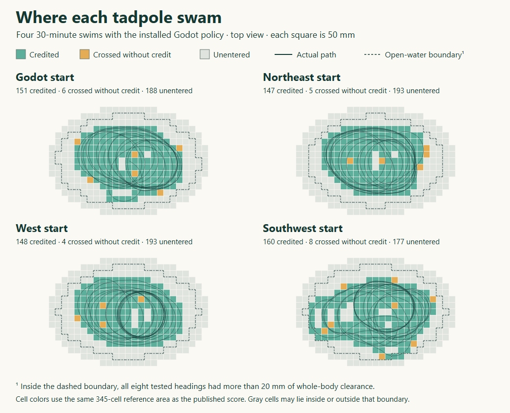

# Pond coverage and the decision to straighten

The installed chooser (appended-16, motor 88) repeatedly follows overlapping loops in open water. It entered an average of **45.58%** of the original 345 scored cells across four separate 30-minute swims and earned credit for **43.91%**. In the default Godot swim it missed **98 open-water cells** whose centers had more than 20 mm of certified whole-body clearance at every tested orientation. The exploration deficit extends well inside the pond.



| Start | Credited | Entered without credit | Unentered | Unentered open-water cells / open-water cells | Credited at 5 / 15 / 30 min |
|---|---:|---:|---:|---:|---:|
| Godot | 151 | 6 | 188 | 98 / 255 | 65 / 117 / 151 |
| Northeast | 147 | 5 | 193 | 83 / 235 | 68 / 118 / 147 |
| West | 148 | 4 | 193 | 95 / 247 | 69 / 125 / 148 |
| Southwest | 160 | 8 | 177 | 84 / 249 | 62 / 130 / 160 |

The original 20 ms evaluator supplied the official per-cell credit flags. The archived 80 ms COM samples and the segments joining them supplied the physical entry overlay. Interpolation added zero cells beyond the sample points in these swims. A between-sample excursion is still possible. Original credit requires a one-second stay and 6 mm net displacement in that cell. The published evaluator grid rounds to the nearest center. The training visitation grid has a half-cell offset, so the two metrics must be identified separately when comparing rewards to outcomes.

Each swim used its own archived body at the tested depth (72, 80, 75 and 75 mm) in the native eight-heading placement check. Of the original 345 cell centers, 345, 341, 345 and 345 had positive clearance in at least one tested heading, respectively. The conservative open-water column requires all eight headings to clear 20 mm. This measures static placement. Transit between centers depends on the actual moving body. The four long swims spent zero time in the near-bank band. The largest uninterrupted angular span in the eight *dedicated* baseline shoreline starts was **11.81°**, measured around pond center within runs of consecutive positive-clearance samples at or below 20 mm.

## Same-state turn exits

This separate experiment uses the rejected episodic-128 chooser and the same fitted gait and frozen motor 88. Replaying the two saved 0.8 s states reproduced all eight archived decision positions and logit vectors exactly. Each branch carried forward the native body, filters, visitation memory and timing. After each intervention the same experimental chooser regained control. No actor or critic learned from the forked actions.

At the north-bank positive-tangent start (phase 9) at 3.2 s, the previous request was 12 mm/s and +8°/s. The chooser assigned 95.617% probability to +8°/s across speeds and 0.0314% to any straight request. For the branches below the requested speed stayed at 12 mm/s.

| Request at the fork | Next free choice | Outcome from the fork | Minimum certified clearance |
|---|---|---|---:|
| Current greedy policy, +8°/s | Guard before the following decision | Stopped at 0.559 s | −0.022 mm |
| Straight for one decision (0.8 s) | +8°/s | Stopped at 1.638 s | −0.009 mm |
| Straight for eight seconds | +8°/s | Passed 40 s | 0.109 mm |
| −4°/s for one decision | +8°/s | Passed 40 s | 0.346 mm |

The 0.8 s straight treatment shows two decision errors in this state. The chooser initially persists with a failing turn. When given a straight interval it reselects the failing turn too soon. Eight seconds was a successful tested duration, and the minimum effective duration is unknown. The briefly reversed turn also worked. These are physical witnesses with small clearance margins. They do not establish deployment safety.

| North-bank state | Fork time after spawn | Passing single decisions out of 15 | Eight seconds straight, same speed |
|---|---:|---:|---|
| Phase 8, negative tangent | 1.6 s | 0 | Pass |
| Phase 8, negative tangent | 2.4 s | 0 | Pass |
| Phase 8, negative tangent | 3.2 s | 3 (+8°/s at every speed) | Guard |
| Phase 9, positive tangent | 1.6 s | 0 | Pass |
| Phase 9, positive tangent | 2.4 s | 3 (−8°/s at every speed) | Pass |
| Phase 9, positive tangent | 3.2 s | 6 (−4 or −8°/s at every speed) | Pass |

All six unforced greedy continuations reached the native clearance guard. A guard means loss of certified clearance. Each greedy action repeated as a one-decision intervention reproduced its corresponding outcome. At 3.2 s, all 16 unforced *sampled* continuations per state also reached the guard, with zero endpoint bootstrap. Phase 8's critic predicted **+7.50** against **−5.05** mean measured discounted return. Phase 9's predicted **+21.36** against **−5.00**. This measures poor valuation at these two exits under the stochastic training policy. The alternative-action returns are conditional on their interventions.

The native diagnostic ran **134 branches in 4.62 s**, with 718,441 attempted and 718,324 accepted physics substeps including the two replay prefixes. The maps reused saved trajectories and static geometry. There were zero optimizer updates. All 11 installed Godot package hashes verified. No candidate was produced or deployed.

**Next learning target.** Give a separate chooser PPO candidate practice leaving familiar loops for unvisited open water, with varied bank approaches where standing down from a turn or briefly reversing can succeed. Judge actual behavior on held-out starts. Preserve original navigation and shoreline gates and compare individual 30-minute coverage and safe continuous shoreline arcs to these baselines. Fixed patterns observed here belong only in the diagnostic.

## Reproduce the measurements

Run from the worktree root. The audit executable inherits the native trainer's reward definitions, binds the portable chooser to the actor in its full checkpoint, and uses its associated critic. Choose an unused output directory. The chart and coverage tables can also be regenerated from the archived geometry without rerunning physics.

```powershell
$build = 'build/flexible-tail/turn-exit-map-v1/native'
cmake -S tools/pond-flexible-tail-chooser -B $build -G "Visual Studio 17 2022" -A x64 -DCUDARL_RELIABLE_CHOOSER=ON -DCUDARL_COVERAGE_CHOOSER=ON -DCUDARL_DISTANT_COVERAGE=ON -DCUDARL_APPENDED_COVERAGE=ON -DCUDARL_CURVED_BANK=ON -DCUDARL_CLOSE_SHORE=ON -DCUDARL_EPISODIC_BANK=ON
cmake --build $build --config Release --target pond_turn_exit_audit
$live = 'flexible-tail-preview/live_data'
$base = 'assets/research-evidence'
$prior = "$base/pond-flexible-tail-episodic-bank-v3/data"
$out = "$build/reproduction"
& "$build/Release/pond_turn_exit_audit.exe" "$live/fitted-gait.bin" "$live/exploration-motor-88.bin" "$prior/training/actor-128.bin" "$live/straight-evaluation-starts.bin" $out 0 --turn-exit "$prior/training/checkpoints/session-128.bin" "$prior/signal-audit/captures" "$prior/shore/update-128/assessment/traces"
node tools/pond-flexible-tail-chooser/analyze-coverage.mjs "$base/pond-flexible-tail-appended-coverage-v3/data/continuous/update-016/assessment" "$base/pond-flexible-tail-curved-bank-v1/data/baseline-shore/assessment" $out
```
