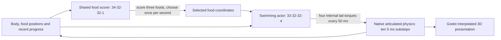

# End-to-end architecture audit and creature directions

October 27, 2026. Audited local commit `a64fcc2` on `codex/portable-pond`, which is newer than the `6b42958` GitHub links supplied in the discussion. This is an architecture/behavior audit and planning document. No gameplay, policy, physics, current control or training implementation was changed for it.

## Scope and validation

Mapped the first-party application, numerical library, environment/trainer families, Godot bindings/scenes, command-line tools, checkpoints, tests, build/staging and CI. The source/config inventory contains 225 tracked files across these directories, plus root build/project documentation. Detailed execution and contract review concentrates on the current deep-pond/recovery path. Third-party Godot/SDK implementation, generated files and binary internals are excluded. This is not a claim that every kernel or every possible failure has been formally proved correct.

Fresh validation on this checkout:

- Native regression: **167/167 pass, zero skipped**, GPU required; 111.31 seconds including the test harness.
- Existing latest-agent Godot integration: **28/28 headless CPU checks and 28/28 headless CUDA checks**. These exercise the actual saved candidate, live stepping/collection, session graph values, random-weight round trips, layout bounds and return to menu. No new rendered/physical-touch inspection was performed for this code-only audit.
- Existing C++-only portable playback suite passes.
- Seven protected original policy/full-save hashes and the selected bank policy are unchanged. Candidate SHA256: `4186F47471EDE2D0034EB566EFA1EC959B03D0A015E686FFA5F4262FCEB4A563`.
- Audit logs and hash details: ignored `build/codebase-audit/`. No ongoing training or profiling run was started; existing regression learning tests use their isolated test state.

The previous validated graphics and reliability evidence remains in [creature_reliability.md](creature_reliability.md). Passing native tests is not evidence of complete interactive learning, shore locomotion or arbitrary-current robustness.

## Whole-project map

| Layer | Actual responsibility and connections |
| --- | --- |
| Build and loading | `CMakeLists.txt` builds the C++-only `cudarl_runtime`, CUDA `cudarl_core`, optional `cudarl_pond_cuda` module, Godot `cudarl` extension and tools/tests. `cmake/PortablePond.cmake` selects the CPU-only build. `src/godot/register_types.cpp` registers classes according to the CUDA build flag. |
| Application | `project.godot` starts `launcher/launcher.tscn`. The `DemoLaunch` autoload routes scenes, keeps watch/train mode, and reads CartPole/Racing JSON policies. `launcher.gd` builds the menu/help and opens an older selector-training console. |
| CartPole | `cartpole.gd` → `PpoLab` → saved CPU showcase or background `TrainingSession<PpoTrainer>` → batched CUDA CartPole, categorical PPO, shared MLP/Adam. The visible carts and hidden training worlds are distinct. |
| Racing | `racing.gd` → `RacingLab` → eight-car showcase and/or `TrainingSession<RacingPpoTrainer>` → Gaussian steering/throttle PPO and CUDA traffic environments. Racing owns its graph submission/timing implementation; it is not automatically used by pond training. |
| Swimmer generations | Original swimmer/inertial/foraging code supports earlier 2D bodies and three-food learning. `TadpoleLab`, `DeepWaterLab` and the preserved training branch of `DeepPondLab` adapt `BasicSwimmerTrainer<Task>` for shallow, one-food 3D and three-food 3D tasks. They have separate task/save formats. |
| Current deep pond | `deep_pond.gd` normally loads packaged `deep_selector.bin`. `latest_agent.gd` instead calls `watch_progress_controller()` with the selected update-320 bank policy. Both use `PondPlayback`; neither trains when playing a saved controller. |
| Numerical library | `GpuMlp` uses the handwritten FP32 GEMM, activation/backprop kernels and Adam. CPU MLP/Adam implementations are references and inference paths. BF16 tensor-core GEMM and attention kernels have separate tests/benchmarks; they are not the creature's deployed architecture. cuBLAS is a benchmark reference, not its policy runtime. |
| Other demos | Function fitting calls `NetworkTrainer`/`FunctionFit` for GPU regression. Maze has a shared plain-C++ environment exposed through `MazeArena`; it is not a learned navigation skill of this creature. |
| Tools and evidence | Native tools cover headless motor/selector training, input-order tests, paired evaluation, current tests, fixed-target isolation, bank-state collection/evaluation, profiling, playback reliability and exports. Experimental policies and raw results are intentionally separate from packaged/default assets. |
| Persistence | `checkpoint` provides checksummed bounded payloads, atomic replacement and exclusive trainer leases. Full trainer state includes much more than actor weights. Policies are small inference bundles; full optimizer/world saves remain local and require separate backup. |
| CI | Current workflow builds CPU-only playback and CUDA code on hosted Windows with no GPU. GPU tests can skip there; Godot integration/render tests are not run by that workflow. Local GPU validation is separate evidence. |

## The active creature, one step at a time

The selector evaluates the same scoring network once for each food, then chooses the highest score during inference. Its shared weights and symmetric context reduce food-slot bias. The original selector has 32 features per candidate; the current one adds time since food and candidate-specific recent distance progress for 34 features. This is explicit history, not learned recurrent memory. The trainer's critic sees the full 40-value observation and exists to estimate value during learning.

The motor receives a 33-value observation: body-relative food offsets, linear/angular velocities, upright direction, joint angles/rates, position and previous actions. The selected food is moved to the primary observation slot; physical food is not teleported. Both hidden layers have 32 tanh units. Its four continuous outputs apply internal yaw/pitch torques at two tail joints. The complete body also has six free-base degrees of freedom. Current motor weights are retained from update 64,350.

Neither policy directly receives the imposed current vector or a contact flag. They do receive motion/pose information, and the selector receives progress. That observation design is a candidate for controlled experiments, not proof that extra sensors or a recurrent network are required.

The physical model uses SI masses/inertias, gravity/buoyancy, distributed viscous/quadratic water-relative drag, soft contact and a semi-implicit articulated solve. It is reduced-order hydrodynamics, not CFD. The visible water shader does not compute those forces. Shore rocks/vegetation are presentation geometry, not additional collision obstacles in the native solver; an interactive physical obstacle would need CPU/CUDA environment support. Food currently stays at sampled locations until eaten; valid water/clearance/separation constraints are explicit, not a proof that every target can always be reached from every settled pose.

CPU and CUDA playback share physical equations but have separate inference/orchestration code. CUDA checks the device and a real kernel, then executes the single world. Automatic CPU fallback retains host state, rather than restarting the creature. The current module API supports create/step/destroy only; both live paths omit the optional current argument and therefore run calm water. Research environments already pass nonzero flow to the same physics.

## How training actually works

Motor learning uses Gaussian PPO in `swimmer_ppo.h`; original food selection uses categorical PPO in `pond_selector_ppo.h`; bank/current selection uses `ProgressTrainer` in `progress_selector_ppo.h`. Shared clipped objectives, GAE with timeout bootstrap, gradient kernels, shuffled minibatches and Adam underpin them. Motor rollouts use 64 control steps; progress-selector rollouts use 32 decisions, each holding its target for 20 control steps. Both use four optimization epochs/eight minibatches in these implementations.

The recovery trainer updates the selector actor and its critic. It has no motor optimizer; the swimming weights stay fixed. Normal practice includes varying resting joints and sampled steady horizontal currents, with calm episodes mixed in. Bank curriculum additionally restores authentic collected body/food/target/history/current states. It rewards collections and penalizes sufficiently slow, long no-food failures. Training can reset failed episodes; live playback does not. The motor's dense progress/smoothness/joint-limit reward is different from this selector reward.

Full progress saves include actor, critic, Adam state, worlds, random/counter state, histories, current vectors and curriculum. `ProgressPolicy` contains an inference actor plus the frozen baseline motor bundle; it is not the resumable learner. Its update number is not the motor update number. `--updates 0` on `pond_progress_train` performs zero additional training updates; the older menu selector runner uses its own continuous-run convention. Do not interchange CLI semantics.

The existing generic background session is useful precedent, but `ProgressTrainer` does not directly implement its Config/Stats/update publication interface. A practice coordinator/adapter, challenge capture and candidate validation/promotion must still be written. Replaying old action/reward logs as current PPO data would be inappropriate: saved challenge states should initialize new rollouts collected by the current training policy.

## Prioritized findings

1. **P1 — missing configured policy can enter training unexpectedly.** `godot-project/pond/deep_pond.gd:96–104` loads saved playback only when the path exists; otherwise it calls `start_training()` with the motor save/source. In the developer build, a missing saved-policy asset can therefore resume/create the legacy motor trainer when the user expected inference. This is a statically verified branch, not a deliberately executed mutation of the user's save. Distinguish an explicit training mode/empty path from a configured missing asset; show a useful error for the latter. Fix before integrating broader interaction/promotion. No fix was made during this planning audit.

2. **P2 — the menu and newest-agent practice pipelines differ.** `launcher.gd:207–227` starts `pond_selector_train` on the original bundle/save. `latest_agent.gd:3–12` watches an archived `ProgressPolicy` produced by `pond_progress_train`. The guide does not resume the newest candidate's full practice state or feed validated updates back into this live viewer. This is an integration gap, not evidence that watching the creature trains it.

3. **P2 — live challenge capture/restore and flow control are absent.** `PondCudaApi` v1 (`src/demos/pond_cuda_api.h:9`) has no current setter, full device-history export or state restore. `PondFrame` contains a host history mirror; `pond_reliability` writes diagnostic frames without a flow/controller/cadence contract. These are insufficient for certified exact current-challenge replay/training from a live encounter. Preserve actual device state, flow, target, history, decision phase, policy and physics identity, with an isolated restore/continuation test. Retain legacy v1/calm behavior when evolving this interface.

4. **Design constraint — the selector's actions are only three foods.** It has no empty-water waypoint, reorient command or control over tail torque. If all available goals fail from a state, selector-only training has limited ways to recover. This makes a goal-conditioned recovery extension worth testing; it does not prove the motor lacks a useful movement. Fixed-target tests reached all 4,608 sampled targets in currents, while difficult settled bank states remain a different distribution.

5. **Design constraint — legs cannot work through animation alone.** `deep_physics.h:57` fixes three links and the state/solver fixes ten degrees of freedom; `contact()` at line 113 supplies normal forces/damping and line 120 explicitly enforces swimming-only surface containment. There is no tangential ground-friction model for bracing. Useful legs need geometry/joints/actuation, mass/inertia/drag, contact/friction, appropriate observations and eventually a revised shore/surface boundary. Existing 27→33 input expansion is a useful transfer precedent, not a ready-made anatomy-growth implementation.

6. **Validation gap — a calm immobility gate cannot establish current competence.** The sixteen thirty-minute playback runs are good bounded calm evidence. The monitor reports food gaps separately but does not fail on poor collection or moving-without-progress behavior. Bank holdout recovery is 83/86 by twenty seconds and 84/86 by sixty seconds; two cases still fail the latter criterion. Long ordinary current probes remain mixed. Candidate promotion needs declared current ranges, recovery/tail metrics and calm retention, not only an average food/minute or passing the calm gate. New selected candidates require new final evaluation data; repeatedly tuning against the same holdout turns it into development data.

7. **P3 — latest previews are development assets.** The newest policy is referenced outside the Godot project under `../docs`; the comparison reads ignored `../build`. The staging script packages the original pond, not these developer previews. This is documented and distribution is paused, so do not turn the audit into packaging work. Move selected deployment assets inside the project and version their manifest when a release is actually planned.

8. **P3 — checkpoint documentation has historical wording.** The previous latest session entry says work is uncommitted, but that code is now committed in `a64fcc2`. The new audit entry corrects current status while leaving historical experiment records intact. No claim is made that the branch is pushed or merged.

## One creature versus one network

One creature can have several neural components and a unified persistent identity. The two current decision networks already act in sequence as one agent; PPO's critics are training helpers. Recovery can extend the current goal interface and/or motor controller without adding a new network for every skill.

A single end-to-end actor, a shared encoder with multiple heads, or later distillation into one actor are possible alternatives. The current system already has a historical all-foods-to-torques actor, so this is not an unexplored idea. The present selector exists because explicit food selection improved behavior. Combining the components now would change action distributions, optimization, timing and retention tests, and could discard a useful diagnostic separation. A bigger network alone does not resolve unattainable goals, missing contact physics or missing training coverage. Keep the working modular agent while testing recovery; revisit consolidation if a measured limitation justifies it.

## Fresh ideas grounded in this code — proposals, not implementation approval

| Idea | What the person experiences | Small technical experiment and honest limit |
| --- | --- | --- |
| A creature that practices its own difficult encounters | Place valid underwater food or introduce gentle flow; the creature responds. A challenge it struggled with becomes a later practice task, followed by a live retest. | Export/restore complete live state, mix nearby variants with normal starts, collect fresh on-policy PPO rollouts and validate a copied candidate before replacing weights. Existing pools/full saves are building blocks, not the completed feature. |
| Learn temporary escape destinations | The creature briefly turns toward open water to uncoil, then returns to feeding without a rescue teleport. | Test the frozen motor on diagnostic empty-water goals from retained difficult states. If successful, generalize the existing shared scorer from food-only candidates to bounded recovery goals; if unsuccessful, train a copied goal-conditioned motor. Any deployed escape decisions/motion must be learned and physically executed, not a scripted animation. |
| A water-skills playground | The same creature can reach food against flow, hold position, turn around and recover after displacement. | Keep two controllers; give the motor a clearly defined goal/task observation, starting with one recovery task and calm retention. Holding station is not automatically taught by food collection; it needs its own objective and evaluation. |
| Difficulty follows demonstrated competence | The pond gently asks more of a creature that can already handle its current challenges. | Sample current strength/direction and food placements from a bounded curriculum, including successful old tasks. Test unfamiliar combinations separately. Do not equate more disturbance with better AI or generate physically impossible challenges. |
| Growth solves a previously observed problem | Later, small legs let the same animal brace on a shallow patch while its tail continues swimming. | First prove contacts/friction and torque behavior, then train a copied body controller across swimming and bracing. Advance through a few defined body sizes with retention checks. Food-earned progression may trigger the stage, but appearance changes do not manufacture learned limb control. |
| A live scientific comparison | Someone can rerun their challenge with the preserved earlier controller and see an actual live difference. | Keep a named baseline and candidate, reset both to the same challenge in separate live trials, and show collection/recovery results. Beyond the initial shared state, policies diverge physically and food consumption can produce different later layouts; describe the comparison protocol rather than imply permanent matched frames. |

The strongest product sequence remains: **interactive feeding → reliable recovery → validated practice and retention → two-leg underwater bracing → shallow crawling → land movement**. A gentle steady current is an excellent controlled challenge within that sequence. The important qualification to the supplied recommendation is that a new recovery skill should follow a motor-capability diagnosis; selector limits alone do not establish that new motor weights are necessary.

## First decision to discuss

Choose one visible interaction (food placement or the already-proposed Calm/Gentle current switch), and one measurable recovery criterion. Before launching another training phase, test the remaining bank states with all three goals and a few diagnostic open-water goals while retaining the motor. Use the outcomes to choose selector goals, motor practice, or observation changes. This is the next proposed bounded experiment, not authorization to implement every item in the table.

For an employer-facing demonstration, the concrete technical story is: **the user created a challenge; a preserved baseline struggled; native PPO practice improved fresh trials; the live creature adopted the validated result and retained swimming.** The library/performance work supports that story. Limbs then extend the same measurable progression once the recovery/practice loop is dependable.
