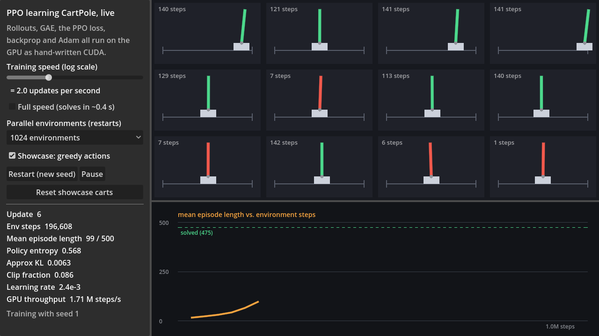
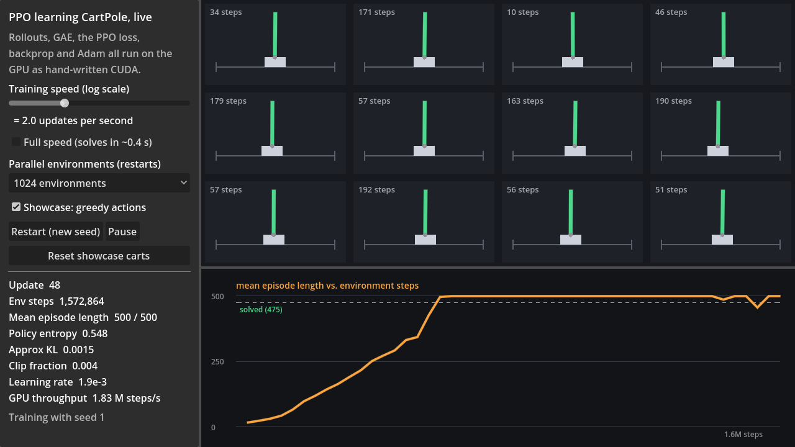

# PPO on CartPole, entirely on the GPU

Proximal Policy Optimization (Schulman et al. 2017) trained on CartPole-v1, written from scratch in CUDA and C++. Rollouts, advantage estimation, minibatch shuffling, the PPO loss and its gradient, backprop, and Adam all run as our own kernels. Per update, the only data copied back to the CPU is a handful of statistics. Godot renders the policy learning in real time.

| | Learning (update 6) | Solved (update 48) |
|---|---|---|
| |  |  |

## Results
RTX 5070, defaults (1,024 environments × 32 steps per update, 4 epochs × 8 minibatches), reproduced with `nn_bench rl`:

| Seed | Updates to solve | Env steps | Wall clock | Worst mean length over the next 40 updates |
|---|---|---|---|---|
| 1 | 20 | 655K | 0.33 s | 457 |
| 2 | 20 | 655K | 0.33 s | 460 |
| 3 | 20 | 655K | 0.33 s | 479 |
| 4 | 19 | 623K | 0.37 s | 489 |
| 5 | 21 | 688K | 0.38 s | 457 |

"Solved" is the CartPole-v1 standard: mean episode length ≥ 475 (of a 500-step maximum), here required for 3 updates in a row. Training runs at about 2 M environment steps per second including the optimization.

The ~20-update figure is partly a measurement floor. A 500-step episode takes 16 updates of 32 steps just to finish, so the policy is good several updates before finished episodes can show it.

Raw environment stepping (`nn_bench rl`, CartPole kernel vs. the same step function in a single-threaded CPU loop):

| Environments | GPU | CPU (1 thread) | Speedup |
|---|---|---|---|
| 16,384 | 2.5 G steps/s | 106 M | 23× |
| 262,144 | **15.9 G steps/s** | 111 M | 143× |
| 1,048,576 | 5.6 G steps/s | 115 M | 49× |

The drop at 1M environments is the cache boundary. At about 90 bytes of state and outputs per environment per step, 256K environments fit in the 48 MB L2, while 1M spill to DRAM and run at the measured 540 GB/s.

## How one update works
1. **Rollout (32 steps).** The actor and critic MLPs run on the current observations, a sampling kernel draws actions from the softmax (with our counter-based RNG) and records log-probabilities, and the CartPole kernel steps all 1,024 environments, one thread each, resetting finished episodes in place.
2. **Bootstrap values.** The critic evaluates the observation after the last step, and the *final* observation of every episode that was truncated at the time limit.
3. **GAE** (γ = 0.99, λ = 0.95). One thread per environment scans backwards through the rollout. A terminated episode contributes no future value. A truncated one bootstraps from V(final observation), because hitting the time limit isn't failure. Many simple PPO implementations treat both cases the same way, which biases the value targets.
4. **Optimization (4 epochs × 8 minibatches).** Each epoch uses a fresh **Feistel-network permutation**: a keyed bijection on the batch indices with cycle walking, so a gather kernel builds minibatches with no sort and no shared state. Per minibatch:
   - Advantages are normalized with a deterministic mean and std reduction.
   - One kernel computes the closed-form gradient of clipped surrogate + entropy bonus + value loss, with respect to the logits and the value.
   - Our MLP backward pass and Adam (with global-norm clipping at 0.5 and linear LR annealing) finish the step.
5. **Stats.** Episode lengths, entropy, approximate KL and clip fraction are reduced on the GPU, and only those numbers are copied to the host.

The actor and critic are separate 4 → 64 → 64 → {2, 1} tanh networks with orthogonal initialization (gain √2 for hidden layers, 0.01 for the policy head, 1 for the value head), implemented with our own Gram-Schmidt. Every reduction runs in a fixed order and nothing uses atomics, so **training is bit-identical for a given seed**, and a test enforces it.

## The one thing that needed tuning
The first run used the usual CartPole hyperparameters (learning rate 2.5e-4, 4 minibatches). It learned to an average episode length of about 170 and then **plateaued**, with an approximate KL of about 1e-4 and a clip fraction of 0. In other words, the policy was barely changing. Those settings come from implementations with batches of about 512 samples that run around 1,000 updates. Here a batch is 32,768 samples, so the gradient is much less noisy, and the same small steps over only 200 updates add up to very little movement. A short sweep (`nn_bench rl lr=... minibatches=...`) showed that **a 10× learning rate (2.5e-3) with 8 minibatches** solves every seed tried, with KL around 0.007 and a clip fraction around 10% early on, which is the range PPO is designed for.

| Setting | Seed 1 | Seed 2 | Seed 3 |
|---|---|---|---|
| lr 2.5e-4, 4 minibatches | not solved (200 updates) | not solved | not solved |
| lr 1e-3, 8 minibatches | 2.18 s | 1.91 s | 0.92 s |
| **lr 2.5e-3, 8 minibatches** | **0.48 s** | **0.49 s** | **0.47 s** |

(These sweep timings ran slightly slower than the final table above.)

## Verification
- **CartPole physics** against a separately written fp64 transcription of the equations. Also tested: termination thresholds, truncation vs. termination on the 500th step, reset determinism, and the GPU batch against the host step over thousands of resets, with zero mismatched episode endings.
- **GAE:** a hand-computed case, a truncation case, and the GPU kernel against an independent reference with random episode ends.
- **The loss gradient** against fp64 finite differences in every regime of the clipped objective (ratio inside the clip range, above it, and below it, each with positive and negative advantage), then the GPU kernel against the host math.
- **Sampling:** action frequencies match the softmax within 5σ over 200K draws, and greedy mode picks the argmax.
- **The shuffle** is a true permutation for every size tested (1 to 100,003) and differs across seeds.
- **End to end:** solves on 3 seeds within 60 updates, training is bit-identical per seed, and a trained policy keeps all 12 showcase carts up for the full 500 steps.

## The live view
`godot --path godot-project` opens it. Training runs on a C++ worker thread (`demos::PpoSession`) with its own non-blocking CUDA stream, publishing stats and a policy snapshot after each update. The 12 showcase carts run on the CPU at the real CartPole rate (50 Hz), because a dozen environments are trivial and shouldn't compete with training for the GPU. Since full-speed training is over in a third of a second, the default speed is throttled to 2 updates per second, which turns the learning into about 10 seconds you can watch. The slider and the "Full speed" box change that.

## Reproduce
```bash
build/Release/cudarl_tests.exe ppo              # unit, gradient and end-to-end tests
build/Release/nn_bench.exe rl                   # throughput, learning curve, 5-seed solve times
build/Release/nn_bench.exe rl lr=2.5e-4 minibatches=4   # the plateau described above
```
