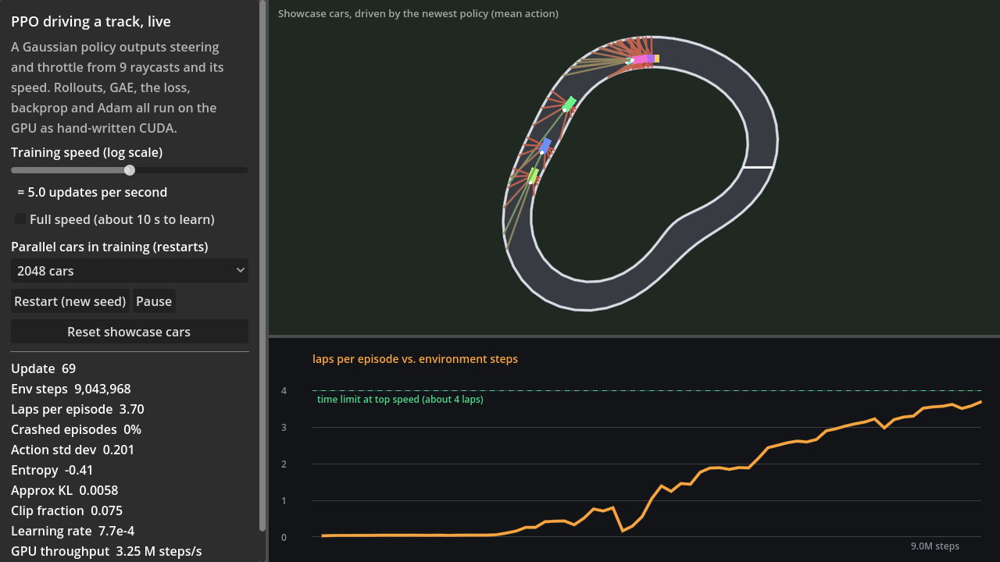

# PPO on a racing track, entirely on the GPU

> Historical single-car results. The current default is the harder eight-car
> circuit described in [Eight-car racing](racing_traffic.md). The original track
> remains a regression mode; its observations now share the enlarged input
> layout. Numbers below describe the earlier 10-input implementation.

A car on a closed track learns to drive from nine raycasts and its own speed. It outputs two continuous actions, steering and throttle, from a Gaussian policy with a learned standard deviation. The critic, GAE, the clipped PPO objective, backprop and Adam all run as our own kernels, and only a few statistics are copied to the host each update. Godot draws the cars, their rays and the learning curve.

## Results

RTX 5070, defaults: 2,048 cars × 64 steps per update (131K samples), 4 epochs × 8 minibatches, 100 updates. Reproduced by `cudarl_tests.exe "3 seeds"`.

| Seed | Laps per episode, update 1 | Laps per episode, update 100 | Share of final episodes that crashed |
|---|---|---|---|
| 1 | 0.03 | 3.91 | 0.0% |
| 2 | 0.03 | 3.81 | 8.3% |
| 3 | 0.03 | 3.91 | 0.8% |

Episodes end at 1,000 steps (50 s) or on a crash. At top speed (15 m/s) a lap of about 188 m takes 12.5 s, so about four laps is the most a car can cover in one episode, and the laps curve flattens at that line. What the policy learns is to finish the time limit without crashing. Lap *time* is a separate question that this setup doesn't measure yet.

Seed 1 over training, from the same 300-update run:

| Update | Env steps | Laps per episode | Crashed | Action std dev |
|---|---|---|---|---|
| 1 | 131K | 0.03 | 100% | 0.61 |
| 26 | 3.4M | 0.44 | 81% | 0.36 |
| 51 | 6.7M | 2.60 | 8% | 0.26 |
| 76 | 10.0M | 3.81 | 0% | 0.19 |
| 101 | 13.2M | 3.91 | 0% | 0.15 |
| 300 | 39.3M | 3.90 | 0% | 0.08 |

Training runs at 3.2–3.6 M environment steps per second over full updates (rollout and optimization together), about 38 ms per update. The plateau arrives at update 76, roughly 3 s of GPU time.

## How one update works

1. **Rollout (64 steps).** The actor produces a mean action for each car. A sampling kernel draws `a = μ + σ ε` with our counter-based RNG and records log π(a). The critic gives V(s). The racing kernel then steps all cars, one thread each: bicycle dynamics, raycasts, the crash test, reward, and resets.
2. **Bootstrap values.** The critic evaluates the observation after the last step, and the final observation of every episode that hit the time limit. A crash bootstraps nothing.
3. **GAE** (γ = 0.99, λ = 0.95), one thread per car, on the GPU.
4. **Optimization (4 epochs × 8 minibatches).** A fresh Feistel-network permutation each epoch feeds a gather kernel. Per minibatch: normalized advantages, the Gaussian PPO gradient with respect to the mean, the log standard deviation and the value, then backprop through the actor and critic, and Adam. The log-std gradient is the sum of the per-sample gradients, and it gets its own Adam.
5. **Stats.** Episode totals, losses and KL are reduced on the GPU. The host copies only those.

## The environment

- **Track.** One fixed closed circuit. The centreline is `r(θ) = 30 + 6 sin 2θ + 2.5 cos 3θ` in polar coordinates, and the walls sit 4 m either side of it, 64 points per wall. The track is star-shaped about the origin, so the polar angle measures progress and the walls can't cross. The track is built once on the host. The GPU reads it from constant memory, where every thread in a warp reads the same segment at once, so each read is a broadcast. The CPU showcase and the Godot drawing use the same data.
- **Car.** A kinematic bicycle model: wheelbase 2.5 m, steering limited to ±0.5 rad, acceleration 6 m/s² at full throttle, drag 0.4/s (top speed 15 m/s), Euler steps of 50 ms.
- **Sensors.** Nine raycasts from −90° to +90° relative to the heading, range 40 m, each tested against all 128 wall segments, plus the car's speed. The observation is 10 numbers.
- **Actions.** Steering and throttle. The policy's raw sample is stored unclipped, so the log-probabilities are exact, and the environment clamps it to [−1, 1].
- **Reward.** 3 per radian of progress (0.1 per metre at radius 30), minus 0.02 × steer² per step, minus 5 on a crash, which ends the episode.
- **Policy.** A Gaussian over the two actions. The mean comes from a 10 → 64 → 64 → 2 tanh MLP with orthogonal initialization (policy-head gain 0.01). The log standard deviation is one learned number per action, independent of the state, starting at −0.5 (σ ≈ 0.61).

## Verification

- **Environment.** The first bicycle step against a hand computation (drag, steering). On a circular track of radius 10, all nine rays read 10 m within 0.05 m. An off-centre car sees the wall ahead 7 m away. A crash ends the episode with the penalty and restarts the car. The time limit truncates at step 1,000. Progress equals the polar angle travelled. The GPU batch matches the host step over 100 steps for 64 cars, with raw actions outside [−1, 1] to exercise the clamp, and the crash decisions agree at every step.
- **Gaussian math.** Log-probability and entropy against their closed forms. The loss gradient with respect to mean, log-std and value against fp64 central differences, in six regimes (the ratio inside, above and below the clip range, with positive and negative advantages) and in a three-dimensional case. Sampling mean and spread over 200K draws. The GPU loss gradient against the host math. `gather_rows` and the episode totals against direct sums.
- **Training.** Bit-identical for the same seed, enforced by a test. Three seeds each reach more than 2.5 laps with crashes below 10% at update 100 (see the table above).

## Limitations and next steps

- **One track.** The policy has seen one circuit. Random tracks are the natural next step.
- **No heading in the observation.** The policy infers its direction of travel from the walls alone. Adding the heading relative to the track would probably speed up learning, but it isn't in the design.
- **Laps saturate at the time limit.** A lap-time metric, with a longer limit or a fixed number of laps, would show driving speed improving.
- **One configuration, no sweep.** The defaults are the first ones tried, and they worked on the first run.
- **Environment throughput isn't benchmarked yet.** The numbers above are for full training updates. The CartPole write-up has a raw stepping table, and a racing one would go next to it.
