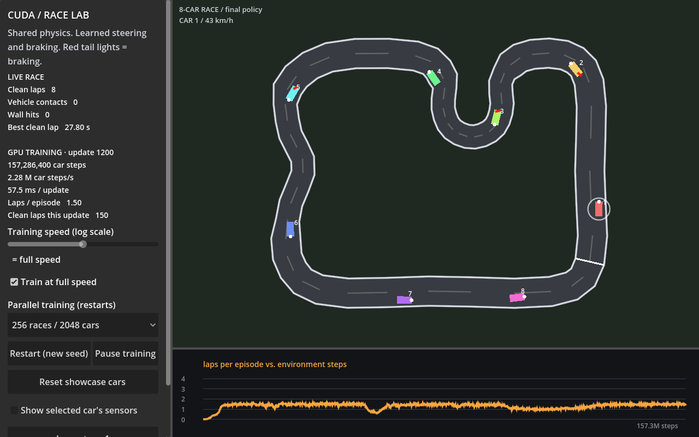

# Eight-car racing showcase

The default Godot scene now trains and displays groups of eight interacting cars
on a harder circuit: a long straight, an infield hairpin, a chicane, and narrower
sections. The original single-car circuit remains available through
`RacingPpoConfig::traffic = false` for regression testing.



## Shared simulation

Training and the CPU showcase call the same host/device functions in
`src/envs/racing/race.h`. CUDA integrates all cars, resolves each race in a fixed
order, and observes the resulting state. There are no atomics or in-place reads
of a neighbour that is still being integrated. Track geometry belongs to each
batch so the two circuits can coexist without overwriting a global track.

The car body rendered by Godot is 4 by 2 metres. Car-to-car collision uses a
conservative 2.25-metre enclosing radius. A swept relative-motion test detects
contact between frames, including crossing trajectories whose endpoints do not
overlap. Both involved cars receive a terminal flag and a crash penalty, and
respawn into clear space. Surviving cars keep their own episodes. Respawns see
the committed survivor positions and previously placed respawns. The eight-car
grid is spaced by route distance and uses a deterministic randomized rotation.

This is crash-and-respawn racing, rather than a rigid-body bounce simulation.
Policies can make contact while learning; the simulator prevents cars from
remaining overlapped or driving through one another. Avoiding all contact is a
learned behaviour, not a guarantee for every seed or traffic arrangement.

The bicycle dynamics use the original 50 ms timestep, 2.5 m wheelbase and 15 m/s
top speed. The traffic circuit adds a 6 m/s² lateral acceleration limit, which
reduces steering authority at high speed and makes braking necessary. Wall tests
cover the front, centre and rear of the car with a capsule approximation.

## Sensors and learning

Each actor and critic receives 30 inputs:

- Nine wall distances over the front 180 degrees.
- Speed, normalized by top speed.
- Nine car distances in the same directions, with walls occluding cars.
- Nine projected relative closing speeds for those detections.
- Sine and cosine of heading relative to the nearest road segment.

The actor remains our fp32 MLP (30 → 64 → 64 → 2) with a Gaussian steering and
throttle policy. The standalone tensor-core attention kernels are not connected
to this policy. Rollouts, GAE, minibatch shuffling, PPO gradients, backprop and
Adam run on the GPU as before.

Progress on the hard circuit uses distance along its centreline, rather than
polar angle. Reward is 12 times signed progress in lap radians, minus 0.002 times
steer squared and 0.01 per step. Crashes cost 5; completing the first full lap
adds 2. The idle cost prevents parking before a corner from becoming the easiest
way to avoid crashes. Episodes still truncate after 1,000 steps (50 seconds),
and the final traffic observation is preserved for value bootstrapping.

## Measured validation

RTX 5070, seed 1, 2,048 cars (256 races), 64 rollout steps, 4 epochs and 8
minibatches, 1,200 updates. One configuration was tested; these are not
multi-seed claims for the harder task.

| Measure | Result |
|---|---:|
| Mean laps per ended episode, first update | 0.019 |
| Mean laps per ended episode, final update | 1.499 |
| Clean laps completed in the final rollout | 150 |
| Full training update throughput, sampled after learning | 2.2–2.8 M car steps/s |
| Separate 60 s deterministic showcase, seed 55 | 8 clean laps |
| Showcase vehicle contacts / wall hits | 0 / 0 |
| Showcase best clean lap | 28.20 s |

Those showcase results use the final policy with its mean actions. No action
noise is sampled during display. A lap time measures one complete forward lap
from that car's spawn point; it resets after a crash. This is a rolling race,
not a standing-start timing comparison. The eight cars have independent episode
boundaries. Training still samples actions: the final rollout had 12 cars involved
in contact and 10 wall crashes. These counts must not be represented as
collision-free training.

Tests cover grid clearance over 64 seeds, wall intersections, swept contact,
car sensing and wall occlusion, braking/steering authority, contact penalties,
clear-space respawns, truncation observations, lap timing, CPU/CUDA parity,
bit-identical traffic training, and end-to-end clean laps. The original circuit
still passes its three-seed learning regression with the enlarged input layout.

The 103-test suite passed before adding the final-observation/lap-clock test.
That additional test and the other seven race-physics tests pass in the final
104-test build. A rendered Godot evaluation also completed eight clean laps in
its fresh 32-second evaluation, with zero vehicle contacts, wall hits or sampled
overlaps and a 27.80-second best lap. Layouts were inspected at 1280×800,
768×1024 and 390×844. Godot signal tests cover car selection, sensors, pause,
resume and training-speed controls; keyboard focus and Tab navigation were also
checked. These are desktop window tests, not physical touchscreen tests.

Run the checks from the repo root:

```powershell
cmake --build --preset release --target cudarl_tests
build/Release/cudarl_tests.exe "race:"
build/Release/cudarl_tests.exe "race learning"
build/Release/cudarl_tests.exe "racing ppo:"
```

## Godot

Run the project from Godot Project Manager, or:

```powershell
& "C:\Users\aiand\Godot\Godot.exe" --path godot-project
```

The race occupies the main view. Cars are numbered, red rear lights indicate
deceleration, and the selected car has a ring and speed readout. Inspect cycles
through all eight cars; the sensor checkbox shows only the selected car's rays.
The sidebar reports live clean laps, vehicle contacts, wall hits and best lap,
plus measured GPU training throughput and update time. Vehicle contacts count
affected cars, so a two-car incident adds two.

After 1,200 updates the final policy keeps racing and the showcase counters
restart for a fresh evaluation. Reset showcase cars restarts that evaluation
without restarting training. Pause training leaves the real-time race running.
Training-speed and car-count controls apply to the worker; choosing a car count
restarts training. Compact windows put the scrollable controls above the race.

### Making learning visible

Training defaults to **two updates per second**. Previously the demo started at
full speed, so the visible cars received many optimized checkpoints before they
had driven far in real time. The throttle now applies when the worker starts as
well as when its speed control changes. Full speed remains available to measure
or demonstrate throughput. The steps/s readout measures active update time,
including optimization; it excludes the deliberate wait between updates.

**Compare: untrained policy** displays this run's exact initialization weights,
captured before any update. The checkpoint stays immutable while training
continues. Switching either way resets the visible race to the same grid and
clears its counters. The caption and sidebar explicitly label the frozen
update-zero view. Switching back applies the latest checkpoint, including after
training has finished. Restart creates a new model/initial checkpoint for the
new seed and clears the comparison state and previous curves.

A direct comparison on seed 1, identical showcase grid/seed 55, and 60 simulated
seconds per policy produced:

| Policy | Clean laps | Wall hits |
|---|---:|---:|
| Actual update-zero weights | 0 | 29 |
| Learned weights after 200 updates | 8 | 0 |

This compares the deterministic mean actions of both policies. It does not add
action noise to the initial policy or change its vehicle physics. The session
test checks the saved initial checkpoint against a freshly constructed trainer
and verifies that training does not overwrite it. The comparison test is
`cudarl_tests.exe "race comparison"`; session regressions use the `ppo_demo:`
filter.

The training throughput includes optimization and differs from kernel-only
benchmark throughput. Simultaneous trainers or other GPU applications can lower
it substantially. Lap times while training are produced by a changing policy.
The clean-lap count is a better measure than a visually smooth frame alone.

Further evidence needed: harder-track learning across multiple seeds, long
contact-free racing evaluations, measured overtaking behaviour, held-out
circuits and randomized conditions. A short clean run does not establish all
of those properties.

## Possible future ideas

Saved at the user's request on October 26, 2026. These are proposals to design
and evaluate later, not approved implementation tasks:

- **Traffic lights:** recognize signal states, stop before the line on red, and
  proceed on green when the junction is clear.
- **Crosswalks with pedestrians:** detect people approaching or occupying a
  crossing, yield, and resume only when the crossing is clear.
- **Stop signs:** make a full stop at the line, then check for conflicts and
  take turns through the intersection.

Together these suggest an intersection/urban-driving challenge alongside the
racing circuit. The simulation, observations, collision rules and evaluation
would need an explicit design. Rule compliance, safe yielding and successful
crossings should be measured separately from lap speed. In particular, legally
waiting at a red light or pedestrian crossing must not receive the current
racing idle penalty, and progress rewards must not encourage running a signal.
